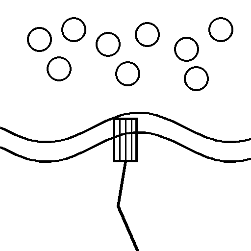
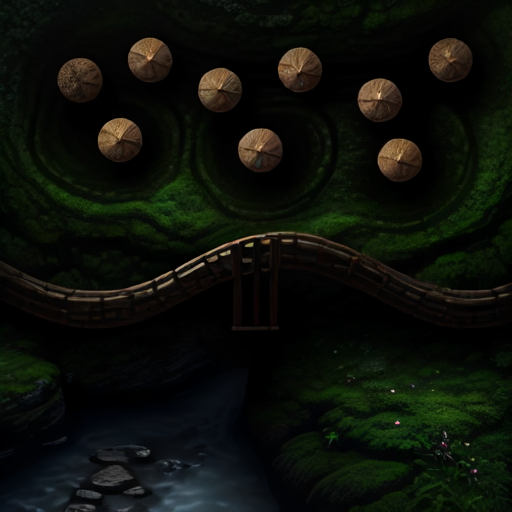

# Canlı servis denemesi — 2026-11-09

`https://api.neuracraft.app`, GM Cebi uygulama token'ı (ağ vekili tarafından eklendi; değeri
günlüklerde yok). İstemci: bu depodaki `lib/data/neuracraft/` (uygulamanın kendisi), betik:
`tool/nc_smoke.dart`.

## 1. İlk deneme (neuracraft-cloud #41 öncesi)

Oturum açıldı, iş reddedildi:

```text
ok   sketch_to_scene v1 is offered
ok   session opened (554936fa-a452-4c72-9ede-0878d9cb9dfb, heartbeat 120 s, capacity NcCapacityWarming)
ok   opening again returns the same session
ok   heartbeat (capacity NcCapacityWarming)
Unhandled exception:
NcApiException(503 job.no_gpu_worker {})
#0      NeuraCraftClient._json (package:gm_cebi/data/neuracraft/client.dart:292:56)
#1      NeuraCraftClient.submitScene (package:gm_cebi/data/neuracraft/client.dart:114:15)
#2      main (file:///…/tool/nc_smoke.dart:55:15)
```

Ardından 20 sn arayla heartbeat. Kapasite önce `warming`, sonra en az 516–806 sn arasında (son 15
ölçüm; daha öncekiler kayda alınmadı) hep:

```text
516s capacity Instance of 'NcCapacityUnavailable'
…
806s capacity Instance of 'NcCapacityUnavailable'
```

Yeni bir oturumda nedeniyle birlikte:

```text
0s  capacity NcCapacityUnavailable no GPU available at the provider
20s capacity NcCapacityUnavailable no GPU available at the provider
```

Servisin açıklaması: Runpod EU Secure Cloud'da A5000/A4000/4090 stoğu tükenmişti.

## 2. #41 deploy'undan sonra

Kapasite (10 sn arayla heartbeat):

```text
0s  capacity NcCapacityWarming eta 90
10s capacity NcCapacityWarming eta 79
21s capacity NcCapacityWarming eta 68
32s capacity NcCapacityWarming eta 58
43s capacity NcCapacityWarming eta 47
53s capacity NcCapacityWarming eta 36
64s capacity NcCapacityWarming eta 26
75s capacity NcCapacityWarming eta 15
85s capacity NcCapacityWarming eta 5
96s capacity NcCapacityReady
```

Uçtan uca deneme (`NC_SMOKE_PRODUCTION=1`):

```text
ok   sketch_to_scene v1 is offered
ok   session opened (51e2eb29-d699-4930-9695-a2dac715cfc7, heartbeat 120 s, capacity NcCapacityReady)
ok   opening again returns the same session
ok   heartbeat (capacity NcCapacityReady)
ok   job submitted (09541fa5-75bc-4c41-9b98-4cb038f8636f)
     events: job:leased, state:running, progress:6/6, job:succeeded
ok   job succeeded in 7226 ms
ok   one output: scene.png (305754 bytes)
ok   downloaded a 512×512 PNG through the redirect
ok   report accepted
     after the report the server answers not_found
ok   cancel accepted (ended cancelled)
ok   unknown job → not_found
ok   malformed X-End-User → partner.end_user_required
skip  bad app token, daily quota (NC_SMOKE_PRODUCTION=1)
ok   heartbeat after close → session.closed
all checks passed
```

İş: `sketch_to_scene` v1, `mode: map`, `seed: 1234`, tarif "Nehrin üzerinde ahşap bir köprü,
kuzeyde sık bir orman". Sonuç deneme sırasında bildirildiği için sunucuda artık gizli; aşağıdaki
kopya yerel.

| Çizim | Sonuç |
|---|---|
|  |  |

Yan yana: [2026-11-09-side-by-side.png](2026-11-09-side-by-side.png).

Gözlem (neuracraft-cloud #42): düzen birebir korunuyor; ama görüntü kuşbakışı değil, daireler ağaç
yerine yuvarlak nesneler, nehir kıyıları ahşap bir korkuluk olmuş.
