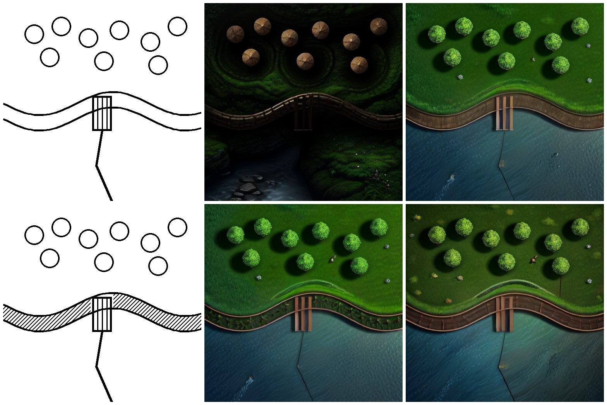
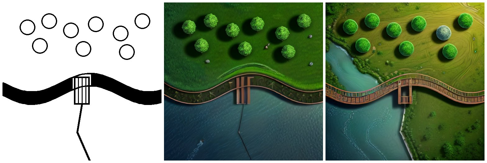
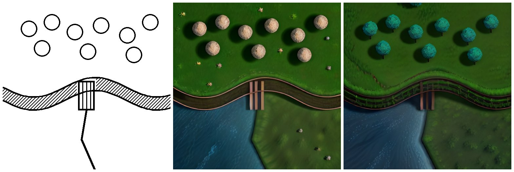

# Harita modu denemesi — 2026-11-10 (neuracraft-cloud #42/#43 sonrası)

`https://api.neuracraft.app`, GM Cebi uygulama token'ı (ağ vekili tarafından eklendi; değeri
günlüklerde yok). Her iş `sketch_to_scene` v1, `mode: map`, 512×512 çizim, aksi yazılmadıkça
`seed: 1234`. Oturum her denemenin sonunda kapatıldı.

## Kapasite ve süre

- GPU: `capacity.gpu = {type: "NVIDIA GeForce RTX 4090", region: "EU-RO-1", modelCache: true}`;
  her işte `job.gpu` aynı.
- GPU zaten sıcaktı (oturum açılır açılmaz `ready`), bu yüzden soğuk başlangıç ölçülemedi.
  Servisin tahmini: model önbelleğiyle ~75 sn, yedek veri merkezinde ~120 sn.
- 7 iş, gönderimden indirmeye 3,1–6,1 sn; sunucuda `startedAt` → `finishedAt` 2,1–2,6 sn.

## Sonuçlar

Üst sıra: 9 Kasım çizimi, 9 Kasım sonucu (#42 öncesi), aynı çizim bugün (a).
Alt sıra: nehrin içi taranmış çizim, (b) aynı açıklama, (c) "İki kıyı arasında akan bir nehir…"
açıklamasıyla.

İçi dolu nehir (d) ve taralı nehir + açıklama, `seed: 7` (e):

Taralı nehir, "köprü" geçmeyen açıklama (f: "İki kıyı arasında akan mavi bir nehir, kuzeyde sık
bir orman, güneyde çayır") ve İngilizce `prompt` (g: "top-down battle map: a blue river flowing
between two grassy banks, a small wooden bridge crossing it, dense forest to the north, a dirt path
to the south"):

## Gözlem

- **Büyük ilerleme:** her sonuç kuşbakışı, aydınlık ve düz bir savaş haritası. Daireler ağaç
  tepesi oluyor (yalnızca f'de saman balyası gibi). Düzen birebir korunuyor.
- **Nehir hâlâ yanlış:** iki çizgi arasındaki şerit hiçbir denemede su olmadı. Şerit ahşap bir
  yürüme yolu/köprü ya da koyu bir hendek oluyor, su ise şeridin güneyindeki boş alanı dolduruyor.
  Güneye inen yol çizgisi suyun içinde ince bir çizgi (a–d) ya da suyun kıyısı (e–g) oluyor.
  İçini taramak, içini doldurmak, açıklamada "iki kıyı arasında akan nehir" demek, "köprü"
  sözcüğünü çıkarmak ve İngilizce istem sonucu değiştirmedi.
- **Köprü:** küçük dikdörtgen üç dikey kalas olarak çiziliyor.
