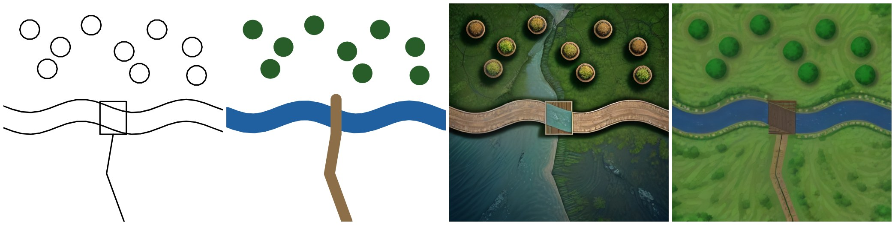
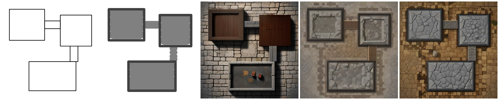

# Alan katmanı denemesi — 2026-11-12 (neuracraft-cloud #42 / #54 canlıda)

`https://api.neuracraft.app`. Çizimler ve bölge katmanları **uygulamanın kendi dışa aktarma
koduyla** (`renderTerrainPng`, `renderRegionsPng`, `lib/features/map_sketch.dart`) test ortamında
üretildi; gerçek cihazda elle çizilmedi. İstekler bu oturumun eski uygulama anahtarıyla gönderildi
(giriş akışıyla değil). Her iş `sketch_to_scene` v1, `mode: map`, `seed: 1234`, 512×512.

## Servis ve uygulama

- `GET /v1/presets` artık `sketch_to_scene` için `inputs` içinde `regions` (`required: false`) ve
  `params.ground` (`grass`, `stone`, `dirt`, `sand`, `snow`) listeliyor. Uygulamanın destek
  denetimi (`NcSceneFeatures.fromPresets`) bu canlı yanıtı tanıyor: bölgeler açık, beş zemin de
  geçerli. Uygulamada değişiklik gerekmedi.
- GPU soğuktu: oturum açılınca `warming` (eta 75 sn, sonra yedek veri merkezi için 109 sn),
  66 sn'de `ready` (RTX A5000, EU-SE-1, `modelCache: false`).
- 5 iş, gönderimden indirmeye 7,0–8,7 sn; sunucuda `startedAt → finishedAt` 1,0–2,1 sn. Bölge
  katmanı işi belirgin biçimde yavaşlatmıyor.

## Nehir

Soldan sağa: çizim, çizim + boyanan alanlar (su Kalın, yol Orta, orman Kalın), yalnızca çizimle
sonuç, bölge katmanıyla sonuç (`ground: grass`). Açıklama: "İki kıyı arasında akan bir nehir,
üzerinde ahşap bir köprü; kuzeyde sık bir orman, köprüden güneye inen toprak bir yol".

- **Yalnızca çizim:** eski sorun aynen duruyor. Şerit ahşap bir yürüme yolu oluyor, su güneydeki
  boş alana ve kuzeye taşıyor, ağaçlar saksı gibi.
- **Bölge katmanıyla:** nehir iki kıyı arasında mavi bir şerit, köprü onu geçiyor, yol güneye
  iniyor, daireler ağaç tepesi, geri kalan çimen. #42'deki sorun bu örnekte çözülmüş.

## Zindan

Soldan sağa: çizim, çizim + boyanan alanlar (odalar ve koridorlar taş zemin, oda duvarları İnce
duvar fırçası), yalnızca çizimle sonuç, bölge katmanıyla `ground: stone`, bölge katmanıyla
`ground: dirt`. Açıklama: "Taş zeminli bir zindan: koridorlarla birbirine bağlanan üç oda, kalın
taş duvarlar".

- **Yalnızca çizim:** odalar ahşap kutu ya da çatı gibi; zemin her yerde taş duvar dokusu.
- **Bölge katmanı, `stone`:** üç oda taş zeminli ve duvarlı, koridorlar yerinde. Ama boyanmayan
  alan da taş döşeme olduğu için oda ile dışarısı birbirine yakın; odalar çukur oda değil,
  yükseltilmiş taş levha gibi okunuyor. İlk koridor ahşap kalas olmuş.
- **Bölge katmanı, `dirt`:** aynı düzen, dışarısı toprak olduğu için odalar çok daha net ayrılıyor;
  koridorlar taş.

## Gözlem ve öneriler

- Alan katmanı nehir sorununu çözüyor; zindanda odaları ve koridorları yerinde tutuyor.
- Zindanda `ground: stone` zayıf kontrast veriyor. Uygulama, boyanan alanın çoğu taş zemin ya da
  duvarsa zemini kendiliğinden "Taş" seçiyor; tek örnek ve tek tohumla bu varsayılanı değiştirmek
  için erken, ama zindan için boyanmayan alanı koyu kaya gibi çizen bir zemin seçeneği (ör. `rock`)
  ya da `stone` zeminin taş zeminden belirgin biçimde koyu çizilmesi daha iyi olur.
- Tek tohum, cihazda çizilmemiş iki örnek: yön için yeterli, ayar için değil. Gerçek tablet
  çizimleri test turundan sonra.

Girdi dosyaları: [nehir çizimi](2026-11-12-river-sketch.png),
[nehir bölgeleri](2026-11-12-river-regions.png), [zindan çizimi](2026-11-12-dungeon-sketch.png),
[zindan bölgeleri](2026-11-12-dungeon-regions.png).
