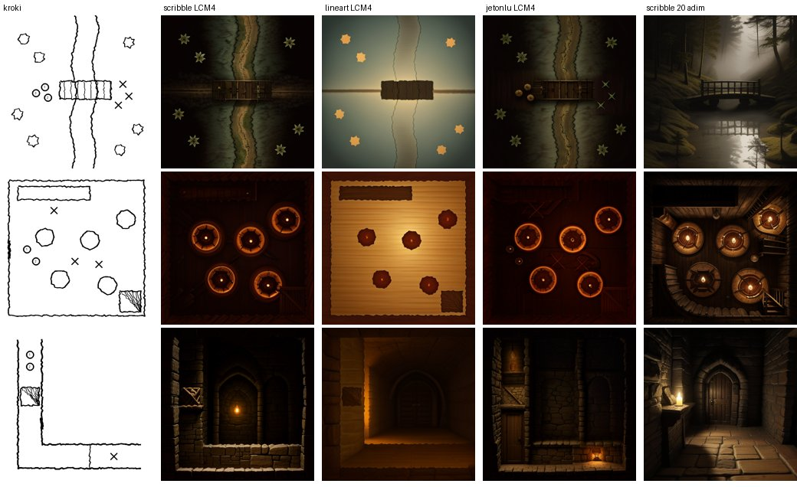
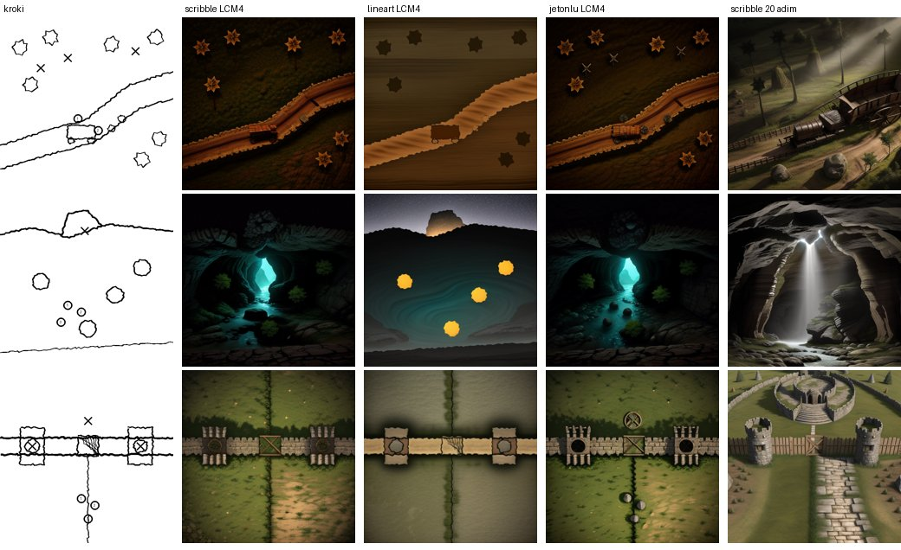
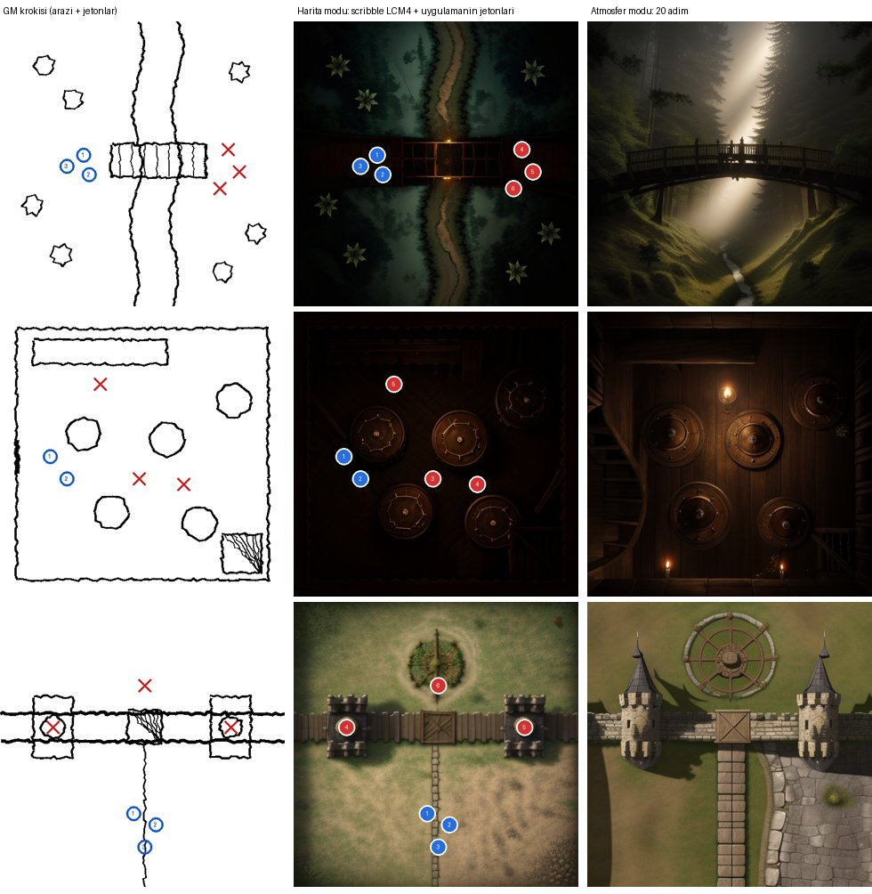

# Deneme: GM krokisinden sahne görseli (2026-11-07)

Soru: GM'in tabletinde savaş sırasında çizdiği basit krokiden ve kısa bir anlatıdan, masada
işe yarayacak bir görsel üretilebilir mi? Ne kadar sürer? Bunun için NeuraCraft'tan ne gerekir?

## Kurulum

- **Donanım:** Runpod Community, 1 × Tesla V100 16 GB ($0,19/saat). Pod yaklaşık 3 dakika açık
  kaldı; maliyet yaklaşık $0,01. Pod iş bitince silindi.
- **Yazılım:** diffusers 0.32.2 + PyTorch 2.4, fp16. NeuraCraft motoru, diffusers ile sayısal olarak
  aynı sonucu verdiğini belgeliyor (ControlNet için fark 2,5e-6). Bu yüzden kalite sorusu için
  diffusers yeterli. Motorun kendisi bu denemede çalıştırılmadı.
- **Modeller:**
  - Temel model: DreamShaper 8 (SD 1.5, CreativeML OpenRAIL-M).
  - ControlNet 1.1: `scribble` ve `lineart` (OpenRAIL).
  - LCM-LoRA SD 1.5.
- **Girdiler:**
  - Krokiler: 6 sentetik, tablet tarzı, tepeden bakış. Titrek çizgiler kullanıldı.
    Sahneler: köprü pususu, han kavgası, zindan koridoru, orman yolu, mağara girişi, kale suru.
  - Anlatılar: her sahne için Türkçe. İngilizce prompt'a çeviri elle yapıldı; üründe bu bir LLM
    adımı olacak (`scenes.json`).
- **Betik:** `tool/spike/sketch2scene.py`. Krokileri üretir, her birini 4 ayarla ve 2 tohumla çizer,
  süreleri ölçer.

## Sonuçlar

Sütunlar: kroki · scribble LCM 4 adım · lineart LCM 4 adım · jetonlar krokinin içinde (scribble
LCM 4) · scribble 20 adım (LCM'siz, CFG 7).

| Ayar | Süre (V100, model sıcak, 512²) | Düzeni koruyor mu? | Görünüm |
|---|---:|---|---|
| scribble + LCM 4 adım | **0,52 sn** (medyan) | Evet: köprü, nehir, masalar, sur, yol yerinde. Zindan ve mağarada perspektife kaçıyor. | Karanlık, düz; ağaçlar yıldıza benziyor |
| lineart + LCM 4 adım | 0,52 sn | Evet ama lekeli | Soluk, ayrıntısız |
| scribble + LCM, **jetonlar krokide** | 0,52 sn | Arazi evet; jetonlar nesneye dönüşüyor (fıçı, lamba, kazıma X) | Jetonlar okunmuyor |
| scribble, 20 adım | 1,62 sn | Gevşek: çoğu sahnede sinematik açıya geçiyor | En güzel ve atmosferik |

- **Model yükleme:** ilk açılışta indirme dahil 46 sn. Model GPU'da yüklü kaldıkça her istek
  yukarıdaki sürelerde.
- **En yüksek VRAM:** 4,3 GB. 8 GB'lık bir GPU yeterli, yani ucuz GPU sınıfları kullanılabilir.

## Çıkarımlar

1. **Hız sorun değil.** Sıcak bir GPU'da harita modu yarım saniyede, atmosfer modu 2 saniyenin
   altında. Masadaki gecikmeyi belirleyen şey soğuk başlangıç (model yükleme ve pod açılışı),
   çizim süresi değil.
2. **İki katman kanıtlandı.** Jetonlar modele gönderilirse bozuluyor. Model yalnızca araziyi
   çizmeli, jetonları uygulama üstüne çizmeli:

   

3. **İki ayrı mod var:**
   - **Harita modu** (scribble + LCM, kontrol ölçeği yüksek): düzeni koruyor, taktik olarak
     kullanılabilir, ama görsel olarak vasat.
   - **Atmosfer modu** (20 adım): güzel ama düzeni koruması beklenmemeli. Üründe "sahneyi
     canlandır" bu mod olmalı. Harita modu, taktik haritaya isteğe bağlı bir "boya" olabilir.
4. **Harita modunun kalitesi için en büyük kaldıraç model seçimi.** Genel bir SD 1.5 modeli
   tepeden savaş haritasını tanımıyor (ağaçlar yıldız, zindan perspektif). Savaş haritası için
   eğitilmiş bir LoRA ya da checkpoint, lisansı uygunsa, ilk denenecek şey. Arazi renklerinin
   (su mavi, bitki yeşil) prompt'a ipucu olarak eklenmesi de denenmeli.
5. **Lineart yerine scribble kullanılmalı.**

## Bu denemenin sınırları

- Krokiler sentetik. Gerçek GM krokileriyle (5–10 tane) tekrarlanmalı.
- Model, LoRA ve kontrol ölçeği taraması yapılmadı. Her ayar için 2 tohum denendi.
- NeuraCraft motoru değil diffusers çalıştırıldı. Motorun `scribble` ControlNet'ini yüklediği
  (mimari aynı, `download_controlnet.sh … scribble`) ayrıca doğrulanmalı.
